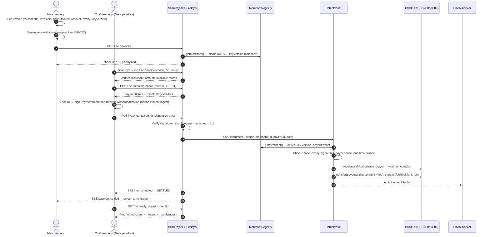
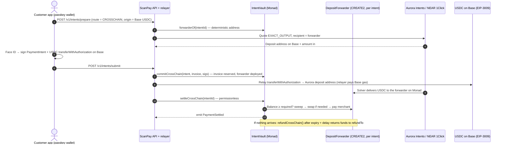

# ScanPay — Scan. Verify. Pay. Know it arrived.

**ScanPay turns a QR scan into a payment you can prove.**

A customer scans a merchant's QR code, sees exactly who they are paying and what they are paying for, approves with Face ID, and the merchant receives USDC or AUSD on Monad. The customer needs no seed phrase, no browser extension and no gas. The blockchain is there to enforce the rules, not to get in the way.

Built for **Monad Metropolis · Track 02 — Consumer Products & Payments**.

| | |
|---|---|
| Live app | https://scanpay-gamma.vercel.app |
| Network | Monad mainnet (chain 143), Monad testnet (chain 10143) |
| Contracts | [`IntentVault`](https://monadscan.com/address/0xa952e8ac92bce001b5ef4ddb1a4027a7b9d2868e) · [`MerchantRegistry`](https://monadscan.com/address/0x2725111582b68539df62d57f579eafcebfb870b0) |
| License | MIT |

---

## Table of contents

1. [Introduction](#introduction)
2. [Problem statement](#problem-statement)
3. [Solution](#solution)
4. [Market context](#market-context)
5. [How a payment flows](#how-a-payment-flows)
6. [Architecture](#architecture)
7. [Mainnet deployment](#mainnet-deployment)
8. [Sponsors and integrations](#sponsors-and-integrations)
9. [Security and trust model](#security-and-trust-model)
10. [Testing](#testing)
11. [Running it locally](#running-it-locally)
12. [Team](#team)

---

## Introduction

Paying by QR code is already a habit for hundreds of millions of people. Paying with crypto is not, because every step asks the user to think like a crypto user: install a wallet, write down a seed phrase, buy a gas token, read a hex address and hope it is the right one.

ScanPay keeps the habit and removes the crypto ceremony:

- **Onboard with a passkey.** The first Face ID creates the wallet. There is no seed phrase to write down and no extension to install. The keys are derived on the device from the passkey (via [Mera](#mera--passkey-wallets)) and never leave it.
- **Pay with one Face ID.** The customer signs a message, not a transaction. A relayer submits it and pays the gas, so the customer only ever holds the stablecoin they spend.
- **Get a receipt anyone can check.** Every payment ends in an on-chain `PaymentSettled` event that the app, the merchant, or a stranger can re-verify against Monad.

For a web2 user it feels like a normal payment app. Under the hood, every rule that matters is enforced by smart contracts.

---

## Problem statement

QR payments ask the customer to trust three things blindly:

1. **That the merchant is who they claim to be.** A QR code is just a picture. A sticker placed over the real code silently reroutes the money, and the customer has no way to tell.
2. **That the amount you approved is the amount taken.** Nothing binds the amount, the token or the recipient you saw on screen to what actually moves.
3. **That the money actually arrived.** At most counters the merchant's only "receipt" is a screenshot of the customer's phone, which is trivial to fake.

Crypto payments could fix this, but in practice they add new problems for normal people: seed phrases, browser extensions, gas tokens, wrong-network errors, and long hex addresses that nobody reads.

---

## Solution

ScanPay replaces each blind assumption with an **on-chain proof that anyone can check**, and hides the crypto plumbing behind a passkey.

### The three proofs

| Proof | Enforced by | What it guarantees |
|---|---|---|
| **Proof of Merchant** | `MerchantRegistry` | The merchant registered on-chain with signatures from both their owner key and their payout wallet over the same digest, so nobody can name someone else's wallet as their payout. Keys are role-separated (owner, payout wallet, invoice signer), all derived from one passkey. Any key or payout change bumps a **key version**, so stale invoices stop working immediately. A verifier role approves merchants before they can accept payments. |
| **Proof of Intent** | `IntentVault` | The merchant signs an invoice; the customer signs a payment intent for the exact amount, token and merchant. Before anything moves, the vault checks both signatures (EOA or ERC-1271), the expiry, a one-time payer nonce and a one-time invoice. A signed payment is worthless for any other purchase, and a replayed one is rejected. |
| **Proof of Settlement** | `IntentVault` | The vault pays the merchant's registered payout wallet exactly the invoiced amount minus the fee, refunds any excess to the payer, and emits a receipt event anyone can verify. On the cross-chain route the vault checks the token balance itself, so no backend can mark a payment as settled. |

### Three ways to pay

| Route | Customer pays with | How it works | Monad transactions |
|---|---|---|---|
| **DIRECT** | USDC or AUSD on Monad | The customer signs an EIP-3009 `receiveWithAuthorization` whose nonce **is the intent digest**, so it can only ever fund that one payment. A relayer submits a single gasless transaction. | 1 |
| **SWAP** | Any allow-listed Monad token (e.g. MON, WETH) | One signature lets the vault pull the input, swap it through an adapter ([Kuru Flow](#kuru-flow--swaps) on mainnet) to exactly the merchant's payout stablecoin, and refund whatever is unused. | 1 |
| **CROSSCHAIN** | USDC on another chain (e.g. Base) | Each intent gets its own deterministic CREATE2 **deposit forwarder**, which is the [Aurora Intents](#aurora-intents--near-1click--cross-chain) recipient. Once funds arrive, anyone can call `settle`; the vault swaps to AUSD if the merchant wants it and pays out. If nothing settles, a permissionless refund path returns the funds after a delay. | 2 (commit + settle) |

### Who it is for

- **Customers** who want to pay by scanning, with Face ID and no wallet setup, and want to see a verified merchant before they pay.
- **Merchants** who want stablecoin settlement in their own wallet, a live feed of invoices and receipts, and no chargeback-style surprises: a payment either settles exactly as signed or does not happen.
- **Cross-border payers** who hold a stablecoin on another chain and need the merchant to still receive a stablecoin on Monad.

---

## Market context

- **QR is already the checkout.** Account-to-account QR systems such as UPI in India, Pix in Brazil and the large wallet apps in China made "scan and pay" an everyday behaviour. Users already understand the gesture; what they lack is a way to verify what happens after the scan.
- **Stablecoins are becoming a settlement rail.** Dollar stablecoins like Circle USDC and Agora AUSD move value in seconds, settle globally and do not depend on card networks. Merchants that accept them get final settlement with no chargebacks.
- **Onboarding is the bottleneck.** The technology works; the user experience does not. Seed phrases, extensions and gas are where mainstream users drop off. Passkeys are already built into every modern phone, which makes them the natural way to bring web2 users on-chain.
- **Cross-border is where proof matters most.** When payer and merchant are on different chains, or in different countries, "trust me, it arrived" is not good enough. A receipt that can be checked on-chain is.
- **Why Monad.** Blocks land in roughly 300–400 ms with fast finality, so a scan-to-receipt payment feels instant at a counter. Cheap transactions make fully relayed, gasless payments practical. The contracts accept plain EOA signatures and ERC-1271, so Mera passkey accounts work with no special handling, and Monad's 128 KB contract-size limit leaves room for a full settlement contract.

---

## How a payment flows

### DIRECT payment (one Face ID, one transaction)

### CROSSCHAIN payment (paid on Base, settled on Monad)

