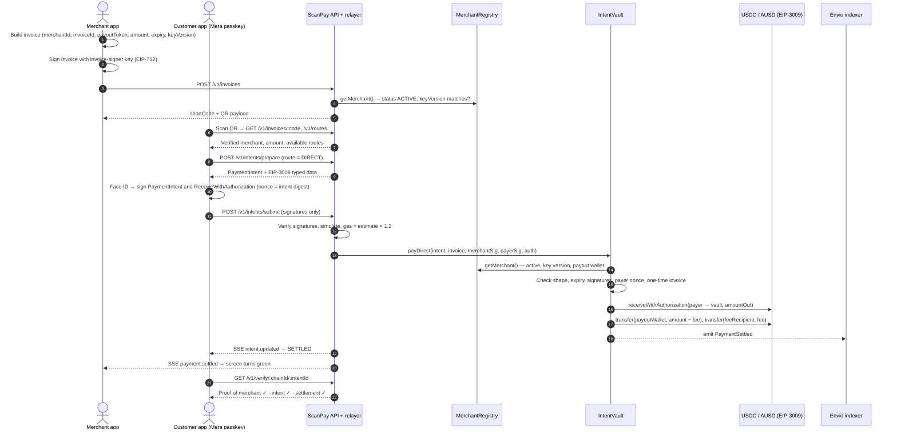
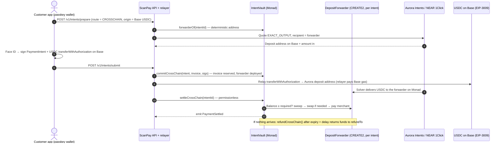
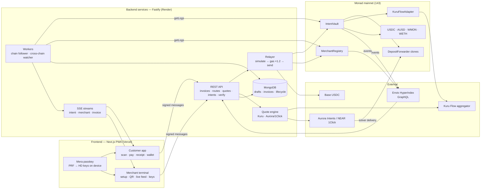
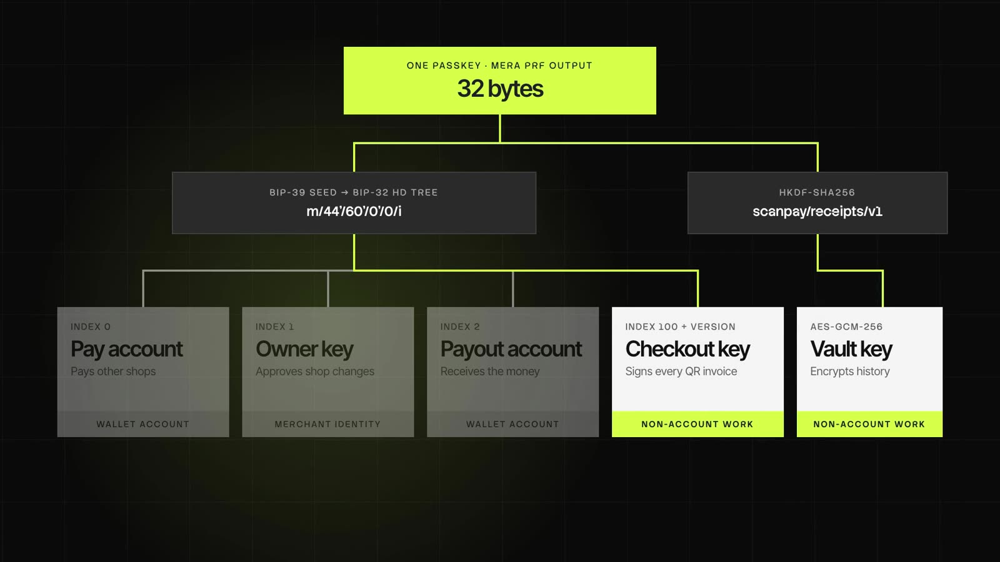
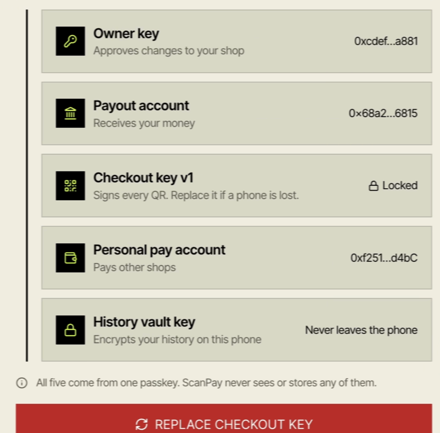

<p align="center">
  <picture>
    <source media="(prefers-color-scheme: dark)" srcset="docs/assets/scanpay-logo-white.png">
    
  </picture>
</p>

<h1 align="center">Scan. Verify. Pay. Know it arrived.</h1>

**ScanPay turns a QR scan into a payment you can prove.**

A customer scans a merchant's QR code, sees exactly who they are paying and what they are paying for, approves with Face ID, and the merchant receives USDC or AUSD on Monad. The customer needs no seed phrase, no browser extension and no gas. The blockchain is there to enforce the rules, not to get in the way.

Built for **Monad Metropolis · Track 02 — Consumer Products & Payments**.

<p align="center">
  
</p>

| | |
|---|---|
| Live app | https://scanpay-gamma.vercel.app |
| Network | Monad mainnet (chain 143), Monad testnet (chain 10143) |
| Contracts | [`IntentVault`](https://monadscan.com/address/0xa952e8ac92bce001b5ef4ddb1a4027a7b9d2868e) · [`MerchantRegistry`](https://monadscan.com/address/0x2725111582b68539df62d57f579eafcebfb870b0) |
| License | MIT |

---

## Table of contents

1. [Introduction](#introduction)
2. [Problem statement](#problem-statement)
3. [Solution](#solution)
4. [Market context](#market-context)
5. [How a payment flows](#how-a-payment-flows)
6. [Architecture](#architecture)
7. [Mainnet deployment](#mainnet-deployment)
8. [Sponsors and integrations](#sponsors-and-integrations)
9. [Security and trust model](#security-and-trust-model)
10. [Testing](#testing)
11. [Running it locally](#running-it-locally)
12. [Team](#team)

---

## Introduction

Paying by QR code is already a habit for hundreds of millions of people. Paying with crypto is not, because every step asks the user to think like a crypto user: install a wallet, write down a seed phrase, buy a gas token, read a hex address and hope it is the right one.

ScanPay keeps the habit and removes the crypto ceremony:

- **Onboard with a passkey.** The first Face ID creates the wallet. There is no seed phrase to write down and no extension to install. The keys are derived on the device from the passkey (via [Mera](#mera--passkey-wallets)) and never leave it.
- **Pay with one Face ID.** The customer signs a message, not a transaction. A relayer submits it and pays the gas, so the customer only ever holds the stablecoin they spend.
- **Get a receipt anyone can check.** Every payment ends in an on-chain `PaymentSettled` event that the app, the merchant, or a stranger can re-verify against Monad.

For a web2 user it feels like a normal payment app. Under the hood, every rule that matters is enforced by smart contracts.

---

## Problem statement

QR payments ask the customer to trust three things blindly:

1. **That the merchant is who they claim to be.** A QR code is just a picture. A sticker placed over the real code silently reroutes the money, and the customer has no way to tell.
2. **That the amount you approved is the amount taken.** Nothing binds the amount, the token or the recipient you saw on screen to what actually moves.
3. **That the money actually arrived.** At most counters the merchant's only "receipt" is a screenshot of the customer's phone, which is trivial to fake.

Crypto payments could fix this, but in practice they add new problems for normal people: seed phrases, browser extensions, gas tokens, wrong-network errors, and long hex addresses that nobody reads.

---

## Solution

ScanPay replaces each blind assumption with an **on-chain proof that anyone can check**, and hides the crypto plumbing behind a passkey.

### The three proofs

| Proof | Enforced by | What it guarantees |
|---|---|---|
| **Proof of Merchant** | `MerchantRegistry` | The merchant registered on-chain with signatures from both their owner key and their payout wallet over the same digest, so nobody can name someone else's wallet as their payout. Keys are role-separated (owner, payout wallet, invoice signer), all derived from one passkey. Any key or payout change bumps a **key version**, so stale invoices stop working immediately. A verifier role approves merchants before they can accept payments. |
| **Proof of Intent** | `IntentVault` | The merchant signs an invoice; the customer signs a payment intent for the exact amount, token and merchant. Before anything moves, the vault checks both signatures (EOA or ERC-1271), the expiry, a one-time payer nonce and a one-time invoice. A signed payment is worthless for any other purchase, and a replayed one is rejected. |
| **Proof of Settlement** | `IntentVault` | The vault pays the merchant's registered payout wallet exactly the invoiced amount minus the fee, refunds any excess to the payer, and emits a receipt event anyone can verify. On the cross-chain route the vault checks the token balance itself, so no backend can mark a payment as settled. |

### Three ways to pay

| Route | Customer pays with | How it works | Monad transactions |
|---|---|---|---|
| **DIRECT** | USDC or AUSD on Monad | The customer signs an EIP-3009 `receiveWithAuthorization` whose nonce **is the intent digest**, so it can only ever fund that one payment. A relayer submits a single gasless transaction. | 1 |
| **SWAP** | Any allow-listed Monad token (e.g. MON, WETH) | One signature lets the vault pull the input, swap it through an adapter ([Kuru Flow](#kuru-flow--swaps) on mainnet) to exactly the merchant's payout stablecoin, and refund whatever is unused. | 1 |
| **CROSSCHAIN** | USDC on another chain (e.g. Base) | Each intent gets its own deterministic CREATE2 **deposit forwarder**, which is the [Aurora Intents](#aurora-intents--near-1click--cross-chain) recipient. Once funds arrive, anyone can call `settle`; the vault swaps to AUSD if the merchant wants it and pays out. If nothing settles, a permissionless refund path returns the funds after a delay. | 2 (commit + settle) |

### Who it is for

- **Customers** who want to pay by scanning, with Face ID and no wallet setup, and want to see a verified merchant before they pay.
- **Merchants** who want stablecoin settlement in their own wallet, a live feed of invoices and receipts, and no chargeback-style surprises: a payment either settles exactly as signed or does not happen.
- **Cross-border payers** who hold a stablecoin on another chain and need the merchant to still receive a stablecoin on Monad.

---

## Market context

- **QR is already the checkout.** Account-to-account QR systems such as UPI in India, Pix in Brazil and the large wallet apps in China made "scan and pay" an everyday behaviour. Users already understand the gesture; what they lack is a way to verify what happens after the scan.
- **Stablecoins are becoming a settlement rail.** Dollar stablecoins like Circle USDC and Agora AUSD move value in seconds, settle globally and do not depend on card networks. Merchants that accept them get final settlement with no chargebacks.
- **Onboarding is the bottleneck.** The technology works; the user experience does not. Seed phrases, extensions and gas are where mainstream users drop off. Passkeys are already built into every modern phone, which makes them the natural way to bring web2 users on-chain.
- **Cross-border is where proof matters most.** When payer and merchant are on different chains, or in different countries, "trust me, it arrived" is not good enough. A receipt that can be checked on-chain is.
- **Why Monad.** Blocks land in roughly 300–400 ms with fast finality, so a scan-to-receipt payment feels instant at a counter. Cheap transactions make fully relayed, gasless payments practical. The contracts accept plain EOA signatures and ERC-1271, so Mera passkey accounts work with no special handling, and Monad's 128 KB contract-size limit leaves room for a full settlement contract.

---

## How a payment flows

### DIRECT payment (one Face ID, one transaction)



### CROSSCHAIN payment (paid on Base, settled on Monad)



---

## Architecture



### Components

| Layer | Path | What it does |
|---|---|---|
| Smart contracts | `backend/contracts/` | Foundry project (Solidity 0.8.28, via-IR, OpenZeppelin v5). `MerchantRegistry`, `IntentVault`, `DepositForwarder`, `KuruFlowAdapter`, plus `MockStableToken` / `MockSwapAdapter` for testnet. |
| Shared SDK | `backend/packages/shared/` | EIP-712 type definitions, typed-data builders, `computeIntentId` / `computeMerchantId`, wire converters, generated ABIs and per-chain deployments. Golden test vectors prove Solidity and TypeScript produce identical digests and signatures. |
| API + relayer | `backend/services/api/` | Fastify + MongoDB. Invoices and QR short codes, route discovery, quotes, intent prepare/submit, gasless relaying, settlement state machine, 3-layer proof verifier, SSE streams, admin approval, Attack Lab. |
| Workers | `backend/services/api/src/worker/` | Chain follower (logs → MongoDB → SSE; only an on-chain `PaymentSettled` can mark a payment SETTLED) and cross-chain watcher (poll provider, settle / refund / attest). |
| Indexer | `backend/indexer/` | Envio HyperIndex schema and handlers for merchants, intents, daily stats, key history and protocol stats. |
| Frontend | `frontend/` | Next.js 16 PWA: landing site plus the app (`/scan`, `/pay/[code]`, `/payment`, `/receipt`, `/wallet`, `/merchant/*`, `/admin`, `/attack-lab`). |
| Deployments | `backend/deployments/` | Generated `143.json` (mainnet) and `10143.json` (testnet) consumed by every layer. |
| Docs | `docs/` | Build specs per layer, runbook, endpoints, gas reference, on-chain evidence. |

### Key derivation (one passkey, many roles)

```
passkey (Face ID) ──PRF──▶ 32 bytes ──▶ BIP-39 entropy ──▶ HD root (kept in memory for one operation)
   m/44'/60'/0'/0/0        payer key          (customer payments)
   m/44'/60'/0'/0/1        merchant owner     (registration, rotation)
   m/44'/60'/0'/0/2        payout wallet      (receives stablecoins)
   m/44'/60'/0'/0/100+v    invoice signer v   (rotated by bumping the key version)
32 bytes ──HKDF-SHA256 (info "scanpay/receipts/v1")──▶ AES-GCM-256 history vault key
```

<p align="center">
  
</p>

Signing runs inside a Mera secp256k1 signing session that is ended immediately after use. Two of the five keys never sign a blockchain transaction: the invoice signer (checkout key) only signs EIP-712 invoices and holds no funds, and the vault key only encrypts the receipt history stored on the device (`frontend/lib/keys.ts`, `frontend/lib/vault.ts`).

---

## Mainnet deployment

**Monad mainnet · chain ID 143 · explorer [monadscan.com](https://monadscan.com) · start block 112857175**

### Contracts

| Contract | Address | Deploy tx |
|---|---|---|
| MerchantRegistry | [`0x2725111582b68539df62d57f579eafcebfb870b0`](https://monadscan.com/address/0x2725111582b68539df62d57f579eafcebfb870b0) | [`0x55bbc399…`](https://monadscan.com/tx/0x55bbc39917bb8cf67f962098c46d3058e5ba1ee00f100288d1a7ca3e00d15b1d) |
| IntentVault | [`0xa952e8ac92bce001b5ef4ddb1a4027a7b9d2868e`](https://monadscan.com/address/0xa952e8ac92bce001b5ef4ddb1a4027a7b9d2868e) | [`0x29576841…`](https://monadscan.com/tx/0x2957684160289cf3ee00578391a26b45ecc9650fcf0dd679c315b608ff4371d9) |
| DepositForwarder (implementation) | [`0xacbed31d720e3792078be35ac6772a43120be585`](https://monadscan.com/address/0xacbed31d720e3792078be35ac6772a43120be585) | deployed by IntentVault |
| KuruFlowAdapter (swap adapter) | [`0xa5e36c82195b38105f0918fba71e4d3f3f51a1f5`](https://monadscan.com/address/0xa5e36c82195b38105f0918fba71e4d3f3f51a1f5) | [`0xc5009b1c…`](https://monadscan.com/tx/0xc5009b1c885963a082cf14a1bb315cf4005ab287a13c3977b22afbb3be01b93a) |

### Tokens (all real assets, no mocks on mainnet)

| Token | Address | Role | EIP-712 domain |
|---|---|---|---|
| Circle USDC | [`0x754704bc059f8c67012fed69bc8a327a5aafb603`](https://monadscan.com/address/0x754704bc059f8c67012fed69bc8a327a5aafb603) | payout · direct · swap input · cross-chain input | `USDC` / `2` |
| Agora AUSD | [`0x00000000efe302beaa2b3e6e1b18d08d69a9012a`](https://monadscan.com/address/0x00000000efe302beaa2b3e6e1b18d08d69a9012a) | payout · direct · swap input | **`Agora Dollar`** / `1` |
| WMON | [`0x3bd359c1119da7da1d913d1c4d2b7c461115433a`](https://monadscan.com/address/0x3bd359c1119da7da1d913d1c4d2b7c461115433a) | swap input | — |
| WETH | [`0xee8c0e9f1bffb4eb878d8f15f368a02a35481242`](https://monadscan.com/address/0xee8c0e9f1bffb4eb878d8f15f368a02a35481242) | swap input | — |

### Configuration

| Setting | Value |
|---|---|
| Protocol fee | 30 bps (0.30%), capped on-chain at 100 bps |
| Cross-chain refund delay | 3600 s after intent expiry |
| Cross-chain input token | USDC |
| Amount cap | 1 USDC / 1 AUSD per payment (hackathon blast-radius limit, enforced by the vault) |
| Kuru allow-listed targets | `0xb3e6778480b2e488385e8205ea05e20060b813cb` (Flow entrypoint), `0x0d3a1be29e9ded63c7a5678b31e847d68f71ffa2` (Flow router) |
| Aurora destination asset | `nep245:v2_1.omni.hot.tg:143_2dmLwYWkCQKyTjeUPAsGJuiVLbFx` (USDC on Monad) |
| Admin / operator / fee recipient | `0xcd8f91dc7929e973ddc071838904434297ab4673` |

### Proven on mainnet

Every route was run end to end through the API against the live contracts and re-verified with `GET /v1/verify/:chainId/:intentId`. The merchant payout wallet was a fresh address each time. Full details: [`docs/evidence/proof-transactions.md`](docs/evidence/proof-transactions.md).

| Route | Amount | Merchant received | Verdict | Transaction |
|---|---|---|---|---|
| DIRECT | 0.05 USDC | 0.04985 USDC | VERIFIED | [`0x623eaa04…`](https://monadscan.com/tx/0x623eaa049e1868b16e80dfbd3ed05778140fc8604ef6e89748084aa268405e92) |
| SWAP (real Kuru) | 0.816 WMON → 0.02 USDC | 0.01994 USDC | VERIFIED | [`0x7054d8d5…`](https://monadscan.com/tx/0x7054d8d5337f548c9b6278300c842a2f31370a728ce1738e9e1d741e0522c1ed) |
| CROSSCHAIN (Base → Monad via Aurora/1Click) | 0.2 USDC | 0.1994 USDC | VERIFIED | commit [`0x89316949…`](https://monadscan.com/tx/0x89316949d6b44a71f95f46a46dbd0904b711e39b41e752f74b5da45f883c7bb3) · settle [`0x9634d8b0…`](https://monadscan.com/tx/0x9634d8b08dac7a0a2042fb76fcabd7dbdedede5aee68bef0ca155486ee602be7) |

DIRECT and SWAP settle in about a second. The cross-chain leg is dominated by the external solver; commit and settle on Monad are one transaction each.

### Testnet (chain 10143)

The same contracts are deployed on Monad testnet at the same addresses (same deployer, same nonce order), all verified on Sourcify / MonadVision. Testnet uses ScanPay's own mock tokens so a testnet reset cannot break the demo, a mock swap adapter (`0x36e1c5c4c98365e83de24f6bc15671561450064c`) and a simulated cross-chain solver, because Agora, Kuru and Aurora have no testnet deployments. See [`docs/endpoints.md`](docs/endpoints.md).

---

## Sponsors and integrations

### Monad — the settlement chain
All contracts live on Monad mainnet. Sub-second blocks make a scan-to-receipt payment feel instant at a counter, and low fees make it practical for the relayer to pay gas for every customer. The deploy uses Foundry's Monad network profile, and the relayer sets `gas = estimate × 1.2` on every transaction because Monad charges on the gas limit, not gas used.

### Mera — passkey wallets
The frontend uses [`@category-labs/mera`](https://www.npmjs.com/package/@category-labs/mera) for onboarding and signing (`frontend/lib/mera.ts`, `frontend/lib/keys.ts`):
- `createPasskeyWithPrfOutput` creates the passkey on the first Face ID and returns its PRF output.
- `getPasskeyPrfOutput` re-derives the same secret on later visits, so the wallet is recovered from the passkey alone, with no seed phrase.
- The PRF output seeds an HD wallet with separate payer, owner, payout and invoice-signer keys.
- `createSecp256k1SigningSession` + `toViemAccount` sign EIP-712 messages inside a short-lived session that is ended immediately after use.
- The same PRF output also derives a non-account key: an AES-GCM vault key (via HKDF) that encrypts the merchant's receipt history on the device.

This is what lets a web2 user go from "scan" to "paid" with Face ID only.

<p align="center">
  
  <br>
  <sub>The merchant Keys page in the live app. All five keys come from one passkey; ScanPay never sees or stores any of them.</sub>
</p>

### Circle USDC — payout and gasless payments
USDC is a first-class payout token and the cross-chain input. Its EIP-3009 `receiveWithAuthorization` powers the one-transaction DIRECT route: the authorization's nonce is the intent digest, so a signature can only ever fund that one payment. On Base, USDC's `transferWithAuthorization` lets the relayer move the customer's cross-chain deposit without the customer holding Base gas.

### Agora AUSD — payout stablecoin
AUSD is the second first-class payout token and also supports EIP-3009 on Monad, so DIRECT payments in AUSD are gasless too. Its EIP-712 domain name is `Agora Dollar`, not `AUSD`; getting it wrong makes every payment revert inside the token, so the domain separators were reconstructed and compared against the live contract. Merchants can choose AUSD as payout and receive it even when the customer pays from another chain: the vault swaps to AUSD at settlement.

### Kuru Flow — swaps
`KuruFlowAdapter` executes Kuru Flow aggregator quotes on behalf of the vault. The API asks Kuru for an exact-output quote with the adapter as the user address, encodes the returned `(target, calldata)` as `swapData`, and the adapter only calls allow-listed Kuru targets. The vault measures output by balance delta and reverts if the merchant would receive less than the invoice. Used by the SWAP route and by cross-chain settlement when the payout token differs from USDC.

### Aurora Intents (NEAR 1Click) — cross-chain
The API requests an `EXACT_OUTPUT` quote whose recipient is the intent's CREATE2 deposit forwarder on Monad, relays the customer's deposit on the origin chain, polls provider status, and lets the vault settle only from the forwarder's real balance. The 1Click API is supported as a fallback provider. The operator's attestation of the source transaction is recorded on-chain but can never move funds or change status.

### Envio HyperIndex — history and analytics
`backend/indexer/` indexes every `MerchantRegistry` and `IntentVault` event into merchants, intents, daily stats, key-history and protocol-stat entities. The API reads merchant payment history, charts, key history and protocol stats from Envio's GraphQL, and falls back to MongoDB when the indexer is unavailable. A hosted deployment runs on Envio Cloud (see `docs/endpoints.md`).

### Also used
- **OpenZeppelin Contracts v5** — AccessControl, EIP712, SignatureChecker (EOA + ERC-1271), Clones, SafeERC20, Pausable, ReentrancyGuard.
- **Foundry** — build, tests, fuzzing, invariants, deploy; contracts verified on **Sourcify / MonadVision**.
- **Base** — first supported origin chain for cross-chain payments.

---

## Security and trust model

Everything that happens on Monad is enforced by contracts. There is exactly one trusted statement: on the cross-chain route, which source-chain transaction funded a deposit is attested by the operator. That attestation cannot move funds or change a payment's status; settlement is decided by the vault checking the forwarder's balance.

| Threat | Defence |
|---|---|
| Replay | Payer nonce, one-time invoice and the EIP-3009 nonce bound to the intent digest each block a second use. |
| Tampering | Changing any field of the intent or invoice breaks the signatures; fuzz tests cover every field. |
| Fake or swapped QR | The invoice must be signed by the merchant's current invoice signer in the registry, and the merchant must be ACTIVE. |
| Stale merchant keys | A key rotation or payout change bumps the key version and invalidates old invoices. |
| Fake "payment arrived" | Only tokens actually sitting in the forwarder can settle a cross-chain intent; the backend can only mark SETTLED after an on-chain `PaymentSettled`. |
| Stuck funds | Late or wrong-token deposits to a forwarder can always be rescued to the payer's refund address. |
| Emergency | The vault can be paused; the cross-chain refund path keeps working while paused. |
| Blast radius | Per-token amount caps on mainnet. |

---

## Testing

| Suite | Command | Tests |
|---|---|---|
| Contracts (unit, attack suite, fuzz, invariants) | `pnpm contracts:test` | 135 |
| Shared SDK (golden vectors Solidity ↔ TypeScript) | `pnpm shared:test` | 15 |
| API (unit + integration) | `pnpm api:test` | 42 |

Contract coverage is about 97% of lines (`docs/test-summary.txt`). Gas measurements live in `docs/gas.md`.

---

## Running it locally

**Requirements:** Node 22+, pnpm 9+, Foundry ≥ 1.8, MongoDB on `:27017`, Docker (only for a local indexer).

```bash
git clone https://github.com/austinjeremiah/Scanpay.git
cd Scanpay
pnpm install
cp .env.example .env            # fill in operator keys, MongoDB, provider keys
```

```bash
pnpm contracts:test             # Solidity tests
pnpm chain:local                # optional: anvil + full local deploy
pnpm api:dev                    # API on :8787 (testnet by default)
pnpm frontend:dev               # app on :3000
```

End-to-end proof of every route against testnet:

```bash
cd backend/services/api
pnpm exec tsx --env-file=../../../.env scripts/e2e-routes.ts 10143 all
```

More detail in [`docs/RUNBOOK.md`](docs/RUNBOOK.md).

---

## Team

| | Role | Built |
|---|---|---|
| [@austinjeremiah](https://github.com/austinjeremiah) | Chain layer | Smart contracts, shared SDK, deployments, indexer, tests |
| [@Suganthan96](https://github.com/Suganthan96) | Services layer | API, gasless relayer, quote engine, settlement watcher, Attack Lab |
| [@sylesh7](https://github.com/sylesh7) | Frontend | Passkey app and ScanPay site |

---

## AI tools disclosure

AI coding assistants were used during development. This README and the project showreel video were produced with Claude Code. The team should list any other AI tools used here, as required by the hackathon rules (§4.1.4).

## License

MIT
